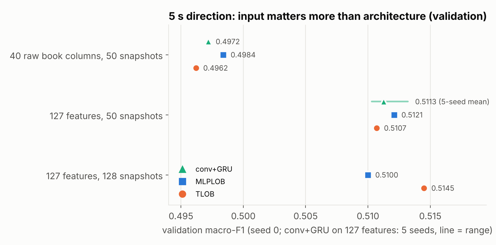
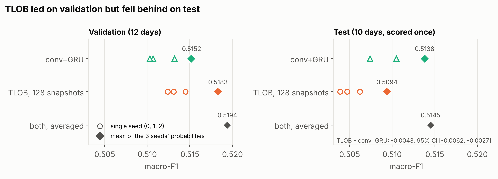
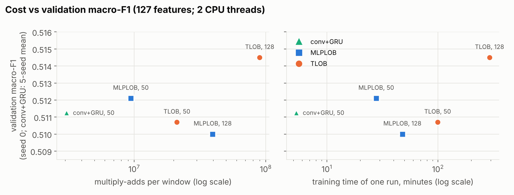
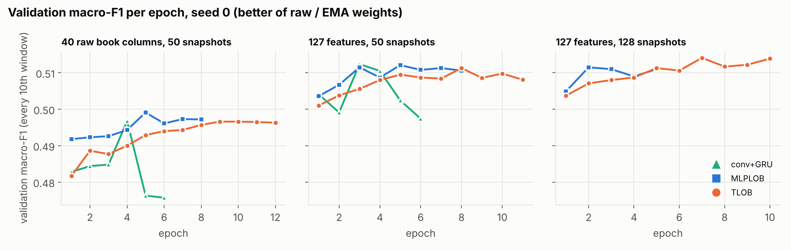

# MLPLOB · TLOB vs conv+GRU: 5초 방향 분류 비교

이 문서는 **방향 분류(5초 뒤 상승 / 보합 / 하락)만** 다룸. MLPLOB·TLOB는 변동성 분류에는 돌리지 않았음. 두 과제의 전체 비교는 [`README.md`](README.md)의 "두 과제 전체 비교"에 있음.

모든 숫자는 `results/lob_models.jsonl`, `results/v2_deep.jsonl`, `results/raw_cmp.jsonl`, `results/lob_cost.jsonl`에서 그대로 옮겼음.
GPU 재실행 결과(9절)는 `results_gpu/lob_models.jsonl`, `results_gpu/v2_deep.jsonl`에서 옮겼음.
연산량과 예측 시간은 `src/lob_cost.py`로 측정했음(아래 4절). 그림과 표는 8절에 있음.
코드는 `src/lob_models.py`이고, 모델은 논문 *TLOB: A Novel Transformer Model with Dual Attention for Price Trend Prediction
with Limit Order Book Data*(Berti & Kasneci, arXiv:2502.15757)의 설명을 보고 다시 구현했음.

## 1. 결론
- **테스트셋에서 TLOB가 기존 conv+GRU보다 유의하게 낮았음.**
  - TLOB 0.5094, conv+GRU 0.5138 (macro-F1, 시드 3개 평균 예측)
  - 차이 −0.0043, 날짜 단위 부트스트랩 95% 구간 [−0.0062, −0.0027]
- 검증셋에서는 TLOB가 +0.003 앞섰지만 테스트셋에서 뒤집혔음. 검증셋 점수로 구성을 고른 데 따른 선택 이득으로 보임.
- 비용은 파라미터 6~25배, 연산량 3~29배, 학습 시간 수 배~수십 배임.
- 메인 모델은 conv+GRU를 유지하고, MLPLOB·TLOB는 비교 실험(부정적 결과)으로만 보고함.
- Apple GPU(M1 Max, MPS)에서 처음부터 다시 돌려도 결론이 같았음: 테스트 TLOB 0.5094, conv+GRU 0.5138, 차이 −0.0043 [−0.0059, −0.0029] (9절).

## 2. 실험 설정
- 과제: 5초 뒤 중간가 방향(하락 / 보합 / 상승) 3클래스 분류, 지표는 macro-F1.
- 분할: 학습 47일, 검증 12일, 테스트 10일(날짜 단위 고정). 테스트셋은 마지막에 한 번만 평가했음.
- 입력
  - `raw`: 10호가 원시 호가 40개 열
  - `full`: Round 2 피처 127개 열
- 학습 규칙(conv+GRU와 동일)
  - epoch마다 학습 창 200,000개를 무작위로 뽑고, batch 256, 최대 12 epoch.
  - epoch마다 검증셋 창의 1/10로 macro-F1을 보고 가장 좋은 epoch의 가중치(raw 또는 EMA)를 저장함.
  - 3 epoch 연속 개선이 없으면 멈춤.
- 논문 설정: MLPLOB 3층, lr 3e-3 / TLOB 4층, head 1개, lr 1e-4, 스냅샷 128개.
- 직접 정한 설정: hidden 64, MLP 확장 ×4, dropout 0.1, 클래스 균형 cross-entropy. MLPLOB의 논문 길이(384)는 CPU에서 감당이 안 돼 128까지만 돌렸음.
- 진행 순서
  1. 6개 구성을 시드 0으로 학습했음.
  2. `full` 구성 4개 중 검증셋 최고(TLOB 128스냅샷)만 시드 1, 2를 추가했음.
  3. 시드 3개 평균 예측을 conv+GRU 시드 3개(`base`, 시드 0~2) 평균 예측과 같은 행에서 비교했음.
  4. 테스트셋에서 한 번 평가했음.

## 3. 결과

### 3.1 검증셋 (시드 0, macro-F1)
| 입력 | conv+GRU | MLPLOB | TLOB |
|---|---|---|---|
| 원시 호가 40개, 50스냅샷 | 0.4972 | 0.4984 | 0.4962 |
| 127개 피처, 50스냅샷 | 0.5113 (시드 5개 평균, 0.5103~0.5132) | 0.5121 | 0.5107 |
| 127개 피처, 128스냅샷 | — | 0.5100 | **0.5145** |

- 원시 호가를 127개 피처로 바꾸면 세 모델 모두 약 +0.014 올랐음. 성능 향상은 모델 구조보다 피처에서 나왔음.
- 50에서 128스냅샷으로 늘리면 MLPLOB는 조금 내려갔고 TLOB는 조금 올랐음.

### 3.2 검증셋, 시드 3개 평균 예측 (같은 행 1,064,299개)
| | 시드별 | 평균 예측 |
|---|---|---|
| TLOB 128스냅샷 | 0.5145 / 0.5124 / 0.5131 | **0.5183** |
| conv+GRU | — | 0.5152 |
| 두 모델 합침 | — | 0.5194 |

### 3.3 테스트셋 (같은 행 920,830개, 한 번만 평가)
| | 시드별 | 평균 예측 |
|---|---|---|
| conv+GRU | 0.5105 / 0.5105 / 0.5074 | **0.5138** |
| TLOB 128스냅샷 | 0.5062 / 0.5047 / 0.5039 | 0.5094 |
| 두 모델 합침 | — | 0.5145 |

- TLOB − conv+GRU: −0.0043, 날짜 단위 부트스트랩(2,000회) 95% 구간 [−0.0062, −0.0027].
- TLOB 시드 3개가 모두 conv+GRU의 가장 낮은 시드보다도 낮았음.
- 두 모델을 합쳐도 conv+GRU 단독보다 +0.0007에 그쳤음.
- 테스트셋 행은 128스냅샷 창과 50스냅샷 창을 둘 다 만들 수 있는 행으로 맞췄음.

## 4. 비용

| 모델 | 파라미터 | 연산량 (창 1개, 곱셈-덧셈) | conv+GRU 대비 | 창 256개 예측 | 창 1개 예측 | 학습 1회 |
|---|---|---|---|---|---|---|
| conv+GRU (50스냅샷) | 61,955 | 306만 | 1배 | 12.5ms | 0.79ms | 5~8분 |
| MLPLOB (50스냅샷) | 391,985 | 943만 | 3.1배 | 53.7ms | 0.77ms | 28분 |
| TLOB (50스냅샷) | 553,823 | 2,111만 | 6.9배 | 105.7ms | 1.85ms | 1.7시간 |
| MLPLOB (128스냅샷) | 1,046,483 | 3,946만 | 12.9배 | 238.6ms | 1.37ms | 48분 |
| TLOB (128스냅샷) | 1,543,955 | 8,979만 | 29.3배 | 456.8ms | 3.23ms | 3.4~5.3시간 |

- 모든 학습과 측정은 CPU 2스레드에서 했음. 예측 시간은 측정할 때마다 조금씩 달라짐(이전에 따로 잰 값은 TLOB 128스냅샷 256개에 578ms였음).
- 연산량은 `torch.utils.flop_counter`로 셌고, conv+GRU는 손으로 계산한 값(합성곱 2층 + GRU 3 게이트 × (입력·은닉 + 은닉·은닉) × 시점 수 + 출력층)과 같은지 확인했음.
- 창을 1개씩 예측해도 모두 4ms 이하라서, 초당 약 4.5개 스냅샷을 처리하는 데는 어느 모델도 문제가 없음. 차이는 학습 시간과 묶음 예측(재학습·백테스트)에서 크게 남.
- MLPLOB·TLOB 전체 학습 시간 합계는 약 18.7시간, 테스트셋 평가는 약 2.4시간이었음.

## 5. 연산 방식의 차이

모델에는 한 번에 여러 시점의 호가 스냅샷이 들어감. 모델은 이 시점들의 정보를 하나로 합쳐 예측함. 세 모델은 이 합치는 방식이 다름.

- **conv+GRU: 순서대로 읽으며 기억하기.** 이웃 시점끼리 합성곱으로 묶은 뒤, GRU가 과거에서 현재까지 하나씩 읽으며 요약을 갱신함.
- **MLPLOB: 고정된 비율로 한꺼번에 섞기.** 모든 시점을 학습으로 정해진 고정 가중치로 섞음. 학습이 끝나면 어떤 입력이 와도 같은 가중치를 씀.
- **TLOB: 입력에 따라 비율을 바꿔 섞기.** attention으로 입력마다 어느 시점이 중요한지 새로 계산해서 섞음.

| 구분 | conv+GRU | MLPLOB | TLOB |
|---|---|---|---|
| 구조 계열 | CNN–RNN 하이브리드 (DeepLOB 계열) | MLP-Mixer 계열 | Transformer (dual / axial attention) |
| 시간축 연산 (token mixing) | 국소 1D 합성곱(kernel 3, 2층 → receptive field 5) + 순환 연산 h_t = GRU(h_{t−1}, x_t), gating | token-mixing MLP, 입력과 무관한 정적 가중치(data-independent), 전역 receptive field | scaled dot-product self-attention softmax(QKᵀ/√d)V, 입력 의존 동적 가중치(content-based), 전역 receptive field |
| 특징축 연산 (channel mixing) | 합성곱의 채널 결합 (127 → 64) | channel-mixing MLP (position-wise FFN) | 전치 후 채널을 토큰으로 둔 self-attention + MLP |
| 귀납적 편향 | 강함: 국소성, 평행이동 등변성, 단방향 순차 처리 | 중간: 위치별 고정 가중치 | 약함: 순열 등변이라 sinusoidal positional encoding으로 순서를 주입 |
| 시퀀스 요약 (readout) | 마지막 은닉 상태 | 전 시점 출력 flatten → FC | 전 시점 출력 flatten → FC |
| 정규화 | 학습셋 통계로 global z-score | global z-score + BiN(창 단위 시간축·특징축 z-score의 학습 가능 가중합) + LayerNorm | MLPLOB와 같음 + pre-LN |
| 시간 복잡도 (길이 T, 차원 d) | O(T·d²), 시간 방향 순차 연산 | O(T²·d + T·d²), 완전 병렬 | O(T²·d + T·d²) + 특징축 O(d²·T + d·T²), 완전 병렬 |

## 6. 해석과 한계
- **피처의 영향 (추정):** 127개 피처가 이미 시간 정보를 많이 담고 있어서, 시점을 더 복잡하게 섞어도 얻을 정보가 적었던 것으로 보임.
- **BiN의 영향 (추정):** BiN은 창 안에서 각 특징의 평균을 빼므로, 스프레드나 잔량이 평소보다 큰지 같은 수준 정보가 일부 지워졌을 수 있음. 이 두 가지는 따로 검증하지 않았음.
- **시드 수:** 느린 구성이라 시드를 3개만 썼음. conv+GRU 비교도 같은 시드 3개(0~2)로 맞췄음.
- **논문과 다른 점:** hidden 크기, MLPLOB 스냅샷 길이(384 대신 128), 학습 예산이 논문과 다름. 데이터도 다름(논문은 FI-2010 등 다른 시장 데이터, 여기는 SK하이닉스 69일).
- **GPU:** Apple GPU(MPS)에서 다시 돌려 확인했음. 학습 시간은 크게 줄었고, 정확도 비교 결론은 그대로였음(9절).

## 7. 재현

```bash
cd src
python lob_models.py S        # 6개 구성, 시드 0 (검증셋)
python lob_models.py M        # 검증셋 최고 'full' 구성의 시드 1, 2
python lob_models.py bagval   # 시드 3개 평균 vs conv+GRU, 검증셋
python lob_models.py test     # 테스트셋 1회
python lob_cost.py            # 파라미터·연산량·예측 시간 -> results/lob_cost.jsonl
python make_tables.py         # report/tables/12~14_lob_models_*.csv (다른 표도 함께 다시 만듦)
python plot_lob.py            # figures/20~23_lob_*.png
```

```bash
python run_lob_gpu.py <원시 .jsonl.gz 폴더>   # GPU 노트북에서 데이터 변환부터 테스트까지 한 번에
```

- 각 단계는 이미 끝난 작업을 건너뛰고, 학습은 epoch마다 저장한 지점부터 이어서 함.
- 결과는 `results/lob_models.jsonl`(GPU 실행은 `results_gpu/`)에 쌓임.

## 8. 그림과 표









| 파일 | 내용 |
|---|---|
| `figures/20_lob_val.png` | 입력(원시 호가 40개 / 피처 127개)과 스냅샷 길이별 검증 macro-F1 |
| `figures/21_lob_val_test.png` | conv+GRU와 TLOB의 시드별 값, 시드 3개 평균, 두 모델 합침 (검증 / 테스트) |
| `figures/22_lob_cost.png` | 연산량·학습 시간 대비 검증 macro-F1 |
| `figures/23_lob_val_curves.png` | 시드 0의 epoch별 검증 macro-F1 |
| `report/tables/12_lob_models_val.csv` | 모든 학습 실행(구성·시드별)의 설정, 최적 epoch, 검증 성능, 학습 시간 |
| `report/tables/13_lob_models_val_test.csv` | 시드별·평균 검증/테스트 macro-F1과 부트스트랩 구간 |
| `report/tables/14_lob_models_cost.csv` | 파라미터, 연산량, 예측 시간, 학습 시간 |

- 학습한 가중치(`results/lob_*.pt`)와 예측 확률(`results/lob_*.npz`)은 데이터에서 만든 파일이라 저장소에 올리지 않았음.

## 9. GPU 재실행 (Apple M1 Max, `results_gpu/`)
- `run_lob_gpu.py`로 원시 데이터 변환부터 테스트까지 처음부터 다시 돌렸음. 코드, 설정, 시드는 CPU 실행과 같음.
- MLPLOB·TLOB는 Apple GPU(MPS)에서, 기준 모델 conv+GRU(시드 0~2)는 같은 노트북의 CPU에서 학습했음.

### 9.1 검증셋 (시드 0, macro-F1)
| 구성 | CPU | GPU | 차이 |
|---|---|---|---|
| MLPLOB, 원시 호가 40개, 50스냅샷 | 0.4984 | 0.4978 | −0.0006 |
| TLOB, 원시 호가 40개, 50스냅샷 | 0.4962 | 0.4955 | −0.0007 |
| MLPLOB, 127개 피처, 50스냅샷 | 0.5121 | 0.5128 | +0.0007 |
| TLOB, 127개 피처, 50스냅샷 | 0.5107 | 0.5105 | −0.0002 |
| MLPLOB, 127개 피처, 128스냅샷 | 0.5100 | 0.5124 | +0.0024 |
| **TLOB, 127개 피처, 128스냅샷** | **0.5145** | **0.5133** | −0.0012 |

- GPU에서도 `full` 구성 중 검증 최고는 TLOB 128스냅샷이라, 같은 구성으로 시드 1, 2를 추가했음(GPU 0.5124 / 0.5134, CPU 0.5124 / 0.5131).
- GPU와 CPU는 계산 순서가 달라 같은 시드라도 값이 조금씩 다름(−0.0012~+0.0024). 가장 큰 차이는 MLPLOB 128스냅샷으로, 최적 epoch도 CPU 2번째, GPU 10번째로 달랐음.
- conv+GRU 시드 0~2의 검증 값은 CPU 실행(`results/v2_deep.jsonl`)과 정확히 같았음(0.5132 / 0.5107 / 0.5103).

### 9.2 시드 3개 평균 예측
| | CPU 실행 | GPU 실행 |
|---|---|---|
| 검증: TLOB 128스냅샷 | 0.5183 | 0.5181 |
| 검증: conv+GRU | 0.5152 | 0.5152 |
| 검증: 두 모델 합침 | 0.5194 | 0.5191 |
| **테스트: TLOB 128스냅샷** | **0.5094** | **0.5094** |
| 테스트: TLOB 시드별 | 0.5062 / 0.5047 / 0.5039 | 0.5054 / 0.5044 / 0.5039 |
| **테스트: conv+GRU** | **0.5138** | **0.5138** |
| 테스트: conv+GRU 시드별 | 0.5105 / 0.5105 / 0.5074 | 0.5105 / 0.5105 / 0.5073 |
| 테스트: 두 모델 합침 | 0.5145 | 0.5146 |
| 테스트: TLOB − conv+GRU (95% 구간) | −0.0043 [−0.0062, −0.0027] | −0.0043 [−0.0059, −0.0029] |

- 검증셋 행 1,064,299개, 테스트셋 행 920,830개로 CPU 실행과 같음.
- 결론은 그대로임: 검증셋에서는 TLOB가 앞섰지만, 테스트셋에서는 conv+GRU보다 유의하게 낮았음.

### 9.3 학습 시간 (epoch당, 분)
| 구성 | CPU 2스레드 | GPU (MPS) |
|---|---|---|
| MLPLOB, 127개 피처, 50스냅샷 | 4.1 | 3.5 |
| TLOB, 127개 피처, 50스냅샷 | 10.1 | 7.7 |
| MLPLOB, 127개 피처, 128스냅샷 | 12.2 | 0.8 |
| TLOB, 127개 피처, 128스냅샷 (시드 0 / 1 / 2) | 32.7 / 34.1 / 32.2 | 7.7 / 1.9 / 1.8 |

- TLOB 128스냅샷은 GPU에서 epoch당 약 4~18배 빨랐음.
- 같은 구성인데도 GPU 실행끼리 epoch당 시간이 크게 달랐음(TLOB 128스냅샷 시드 0은 7.7분, 시드 1·2는 1.8~1.9분). 결과 파일에는 원인이 남아 있지 않음. 노트북에서 동시에 돌던 다른 작업 등의 영향으로 추정함. 시간 비교는 참고용임.
- 학습을 중단했다가 이어서 한 경우에도 epoch당 시간은 실제로 학습한 시간만 더해서 계산함.
