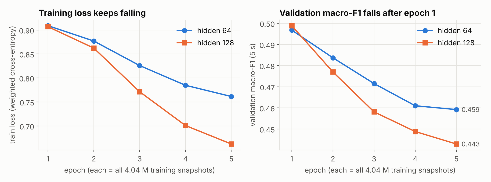

# 호가창으로 시장 상태 분류하기: SK하이닉스 실시간 호가·체결 데이터

직접 수집한 KRX 실시간 호가·체결 데이터로 **다음 순간의 시장 상태를 분류하는 모델**을 학습하고 평가한 딥러닝 기말 프로젝트임.

두 과제를 따로 다루고, 코드·결과·문서도 과제별로 나눴음.

| | 방향 예측 | 변동성 예측 |
|---|---|---|
| 질문 | 5초 뒤 중간가가 상승 / 보합 / 하락 중 무엇일지 | 다음 60초 동안 가격이 잔잔 / 보통 / 격렬 중 어떻게 움직일지 |
| 최고 테스트 macro-F1 | 0.5185 (Round 3, 무작위 약 0.33) | 0.6637 (Round 5·7, 직전 60초 상태 그대로 0.6006) |
| 문서 | [`DIRECTION.md`](DIRECTION.md) | [`VOLATILITY.md`](VOLATILITY.md) |
| 코드 | `src/direction/` | `src/volatility/` |
| 결과·가중치·예측 | `results/direction/` | `results/volatility/` |

두 과제가 함께 쓰는 데이터·피처 코드는 `src/common/`에 있음.

## 데이터

| 항목 | 값 |
|---|---|
| 종목 | SK하이닉스 (000660), KRX 정규장 09:00–15:20 |
| 출처 | 한국투자증권(KIS) 실시간 WebSocket, 호가 H0STASP0 · 체결 H0STCNT0 |
| 기간 | 2026-07-09 ~ 2026-11-09, 69거래일 |
| 규모 | 호가 스냅샷 약 603만 개 (평균 약 0.2초 간격), 체결 약 1,512만 건 |
| 입력 피처 | 71개: 호가 모양, 잔량 불균형, 주문 흐름(OFI), 과거 수익률, 시간대 |

원본 데이터는 저장소에 포함하지 않음. 형식과 배치 방법은 [`data/README.md`](data/README.md)에 있음.

### 날짜순 분할

| 구분 | 기간 | 일수 | 스냅샷 | 용도 |
|---|---|---|---|---|
| 학습 | 07-09 ~ 10-02 | 47 | 약 404만 | 모델 학습 |
| 검증 | 10-06 ~ 10-26 | 12 | 약 107만 | 모델·설정 선택 |
| 테스트 | 10-27 ~ 11-09 | 10 | 약 92만 | 마지막에 한 번만 평가 |

모든 선택은 검증셋에서만 했고, 테스트셋은 최종 평가에 한 번만 썼음.

## 주요 결과 (테스트 기간)

평가 지표는 macro-F1임. 방향 분류는 보합이 약 60%라서 정확도만 보면 "항상 보합"이 유리하기 때문임. 무작위로 찍으면 약 0.33임.

**두 과제 전체 비교 (macro-F1)**

두 과제는 정답이 달라서 모델을 과제별로 따로 학습했음. 같은 구조(예: conv+GRU)라도 가중치는 별개임.

| 단계 | 방법 | 방향 5초 검증 | 방향 5초 테스트 | 변동성 60초 검증 | 변동성 60초 테스트 |
|---|---|---|---|---|---|
| 단순 기준 | 방향: 항상 보합 / 변동성: 시간대만 | 0.2564 | 0.2498 | 0.4395 | 0.4306 |
| 단순 기준 | 방향: 모멘텀 / 변동성: 직전 60초 클래스 그대로 | 0.3486 | 0.3612 | 0.5774 | 0.6006 |
| Round 1 | 로지스틱 회귀 | 0.5012 | 0.4985 | 0.6259 | 0.6494 |
| Round 1 | GBM | 0.5024 | 0.4961 | 0.6186 | 0.6545 |
| Round 1 | DeepLOB | 0.4895 | 0.4782 | — | — |
| Round 1 | conv+GRU | 0.5109 | 0.5067 | 0.6260 | 0.6539 |
| Round 2 | 검증 최고 (방향: GBM + conv+GRU 2종 평균 / 변동성: GBM 회귀 + 경계값) | 0.5179 | 0.5172 | 0.6412 | 0.6612 |
| Round 2 | 같은 설정, 학습+검증으로 다시 학습 | — | 0.5095 | — | 0.6606 |
| MLPLOB·TLOB | TLOB 128스냅샷, 시드 3개 평균 (방향만) | 0.5183 | 0.5094 | — | — |
| MLPLOB·TLOB | 같은 행의 conv+GRU, 시드 3개 평균 | 0.5152 | 0.5138 | — | — |
| **Round 3** | **stacking (검증 최고)** | **0.5194** | **0.5185** | **0.6422** | **0.6630** |
| Round 4 | 변동성만: GBM 회귀 0.8 + conv+GRU 회귀 0.2 혼합 | — | — | 0.6415 | 0.6625 |
| **Round 5** | **변동성만: GBM 회귀 0.7 + 보조 정답 conv+GRU 회귀 0.3 혼합** | — | — | **0.6423** | **0.6637** |
| Round 7 | 변동성만: 시장 전체 정보 피처를 더한 GBM 회귀 0.9 + conv+GRU 회귀 0.1 혼합 | — | — | 0.6430 | 0.6637 |

- 방향 분류: 무작위(약 0.33)보다 확실히 높지만 0.52 안팎에서 멈췄음. Round 3가 Round 2보다 +0.0014로 유의하게 높았음.
- 변동성 분류: 0.66 안팎으로 더 잘 맞히지만, 직전 60초 클래스 그대로(0.60)와의 차이는 약 0.06임. Round 3와 Round 2의 차이는 유의하지 않았음.
- 변동성 Round 4(conv+GRU를 회귀로 학습해 GBM 회귀와 섞음)는 Round 2보다 테스트 +0.0015로 유의하게 높았지만, 검증 반쪽 확인에서는 이득이 없었고 Round 3와는 차이가 없었음([`VOLATILITY.md`](VOLATILITY.md) 5절).
- 변동성 Round 5(보조 정답으로 학습한 conv+GRU를 GBM 회귀와 섞음)가 테스트 최고(0.6637)임. Round 2·4보다 유의하게 높았지만 Round 3와는 차이가 없었고, 검증 반쪽 확인에서는 이득이 보이지 않았음([`VOLATILITY.md`](VOLATILITY.md) 6절).
- 방향 분류에 피처 18개를 더하거나 변동성과 같이 학습시킨 시도(Round 5)는 검증셋에서 오히려 낮아서 테스트하지 않았음.
- 변동성 GBM 회귀를 6가지로 바꿔 본 시도(Round 6: 피처 추가, Poisson 손실, 느린 학습, 학습 데이터 5배 등)는 모두 Round 2 GBM 회귀를 넘지 못했음([`VOLATILITY.md`](VOLATILITY.md) 7절).
- 시장 전체 정보 피처(KOSPI200·삼성전자·나스닥 선물·원/달러 시간봉, 간밤 미국 반도체지수·VIX 등 24개, Round 7)는 변동성 GBM 회귀를 검증·테스트 모두 조금 올렸지만(테스트 0.6609 → 0.6622), 방향 분류에는 도움이 되지 않았음([`VOLATILITY.md`](VOLATILITY.md) 8절).
- 큰 매수 주문을 나눠 낼 때 "격렬" 예측 구간을 피하는 시뮬레이션에서는 비용이 줄지 않았음. 격렬할 때 한 번 사는 비용은 실제로 더 높지만, 미룬 물량을 몰아 사는 비용이 더 커서 정답을 미리 알아도 효과가 없었음([`VOLATILITY.md`](VOLATILITY.md) 9절).
- 검증 기간에서 고른 개선 규칙(격렬하면 조금 덜, 잔잔하면 조금 더 사기)은 비용을 3~5% 줄였지만 유의한 것은 작은 주문뿐이었고, 모델 예측은 "직전 60초 상태"라는 단순 규칙보다 나을 것이 없었음. 체결 비용은 미래 변동성보다 지금 호가 두께에 달려 있기 때문임([`VOLATILITY.md`](VOLATILITY.md) 10절).
- MLPLOB·TLOB는 방향 분류에만 돌렸고 변동성 분류에는 돌리지 않았음.
- 표는 `report/tables/15_two_tasks_summary.csv`(결과 파일에서 코드로 생성)와 같음. 아래 두 표는 Round 1 결과임.

**방향 분류 (5초)**

| 모델 | macro-F1 | 정확도 |
|---|---|---|
| conv+GRU (튜닝) | **0.507** | 0.551 |
| 로지스틱 회귀 | 0.499 | 0.544 |
| GBM | 0.496 | 0.523 |
| DeepLOB | 0.478 | 0.505 |
| 모멘텀 규칙 | 0.361 | 0.478 |
| 항상 보합 | 0.250 | 0.599 |

**변동성 분류 (60초)**

| 모델 | macro-F1 | 정확도 |
|---|---|---|
| GBM | **0.655** | 0.649 |
| conv+GRU | 0.654 | 0.648 |
| 로지스틱 회귀 | 0.649 | 0.642 |
| 직전 60초 클래스 그대로 | 0.601 | 0.596 |

**알게 된 것**
- 방향 분류는 찍기보다 확실히 높지만, 하이퍼파라미터 튜닝·체결 데이터 추가·전체 데이터로 긴 학습 모두 0.50을 넘지 못했음. 긴 학습은 오히려 과적합을 만들었음(검증 0.50 → 0.44).
- 가장 큰 영향을 준 설정은 클래스 가중치였음(제거 시 0.51 → 0.41).
- 원시 호가만 입력하면 GRU가 트리 모델보다 유의하게 높았지만(날짜 단위 bootstrap), 로지스틱과는 차이가 없었고 피처 71개를 쓴 경우보다 낮았음.
- 모델이 확신할 때만 답하면 다음 가격 변화 방향을 상위 약 4%에서 0.87 적중했음.
- 수수료·세금·스프레드를 넣은 백테스트는 모든 전략이 손실이었음.

방향 예측은 [`DIRECTION.md`](DIRECTION.md)(Round 1은 [`RESULTS.md`](RESULTS.md), Round 3은 [`ROUND3.md`](ROUND3.md), MLPLOB·TLOB 비교는 [`LOB_MODELS.md`](LOB_MODELS.md))에, 변동성 예측은 [`VOLATILITY.md`](VOLATILITY.md)에, 발표 자료·결과 표·그래프 목록은 [`report/`](report/README.md)에 정리했음.

<p align="center">
  
  
</p>

## 저장소 구조

```
preprocess/            원본 jsonl.gz -> 하루 단위 npz 변환 (손상된 gzip 복구 포함)
src/
  common/              두 과제 공통: 데이터 경로·날짜 분할·피처·라벨 (common.py), 피처 캐시, 시장 피처,
                       v2 피처 열·불러오기·GBM 설정 (data_v2.py), conv+GRU 등 시계열 모델 (seq_models.py), 그림 스타일
  direction/           방향 예측 (5초): Round 1 모델 선택·튜닝·백테스트, Round 2 (exp_v2.py, deep_v2.py, 결합), Round 3,
                       MLPLOB·TLOB 비교, 그림
  volatility/          변동성 예측 (60초): vol_cls.py, Round 2~7 (vol_v2.py ... mkt_r7.py), 체결 비용 시뮬레이션, 그림
  report/              두 과제의 결과 파일로 요약 표(CSV) 생성 (make_tables.py)
results/
  direction/           방향: 결과 기록(.jsonl), 모델 가중치(.pt, .pkl), predictions/ (정답 라벨을 뺀 최종 예측)
  volatility/          변동성: 같은 구성
results_gpu/direction/ Apple GPU(MPS)로 다시 돌린 MLPLOB·TLOB 비교 (run_lob_gpu.py)
report/                발표 자료, 결과 표(CSV), 결과물 설명
figures/               발표용 그림
DIRECTION.md           방향 예측: 라운드별 결과와 파일 안내
VOLATILITY.md          변동성 예측: 정답 정의, 라운드별 결과, 체결 비용 시뮬레이션
RESULTS.md             Round 1 전체 결과 (데이터 수집, 모델 선택, 튜닝, 부록 실험)
ROUND3.md              방향 Round 3: 시드 추가, 학습 변형, stacking
LOB_MODELS.md          방향: MLPLOB·TLOB와 conv+GRU 비교, CPU / Apple GPU 실행 비교
run_all.sh             Round 1 전체 실행 순서
```

- 각 코드 폴더의 `_paths.py`가 네 폴더를 모두 불러오기 경로에 넣어 줘서, 다른 폴더의 모듈도 그대로 불러올 수 있음.
- 방향 코드와 변동성 코드는 서로 불러오지 않고 `src/common/`만 함께 씀(Round 5 선별이 방향 기준점으로 `results/direction/v2_deep.jsonl`을 읽는 것만 예외).
- 모델 가중치와 예측은 각 결과 폴더의 `README.md`에 파일별로 설명했음. 예측 파일에는 원본 데이터에서 만든 정답 라벨(`y`)을 넣지 않았음.

## 실행

```bash
pip install -r requirements.txt
./run_all.sh
```

- 스크립트는 자기 폴더에서 실행함(예: `cd src/volatility && python vol_r4.py val`). 결과는 과제에 따라 `results/direction/` 또는 `results/volatility/`에 이어 쓰고, 이미 끝난 실험은 건너뜀.
- 라운드별 실행 순서는 [`DIRECTION.md`](DIRECTION.md), [`ROUND3.md`](ROUND3.md), [`LOB_MODELS.md`](LOB_MODELS.md), [`VOLATILITY.md`](VOLATILITY.md)의 재현 절에 있음.
- 딥러닝은 CPU에서 학습했고(4코어), 전체 실행에는 여러 시간이 걸림.

## 라이선스

코드는 [MIT 라이선스](LICENSE)를 따름. 데이터는 포함되어 있지 않으며 재배포할 수 없음.
