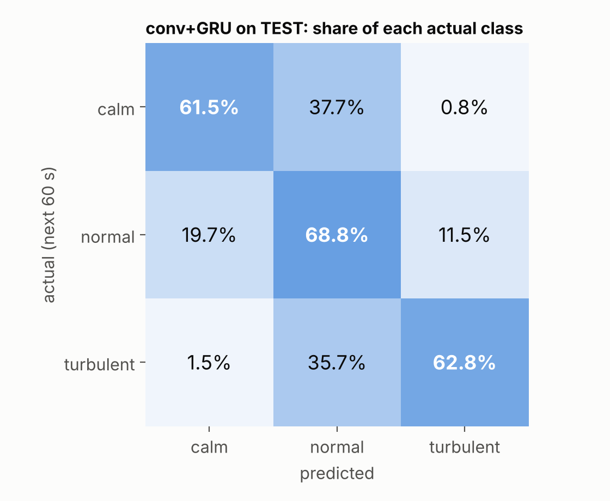

# 호가창으로 시장 상태 분류하기: SK하이닉스 실시간 호가·체결 데이터

직접 수집한 KRX 실시간 호가·체결 데이터로 **다음 순간의 시장 상태를 분류하는 모델**을 학습하고 평가한 딥러닝 기말 프로젝트임.

- **방향 분류:** 5초 뒤 중간가가 상승 / 보합 / 하락 중 무엇일지
- **변동성 분류:** 다음 60초 동안 가격이 잔잔 / 보통 / 격렬 중 어떻게 움직일지

변동성 분류의 정답을 만드는 방법과 클래스 경계, 결과는 [`VOLATILITY.md`](VOLATILITY.md)에 정리했음.

## 데이터

| 항목 | 값 |
|---|---|
| 종목 | SK하이닉스 (000660), KRX 정규장 09:00–15:20 |
| 출처 | 한국투자증권(KIS) 실시간 WebSocket, 호가 H0STASP0 · 체결 H0STCNT0 |
| 기간 | 2026-07-09 ~ 2026-11-09, 69거래일 |
| 규모 | 호가 스냅샷 약 603만 개 (평균 약 0.2초 간격), 체결 약 1,512만 건 |
| 입력 피처 | 71개: 호가 모양, 잔량 불균형, 주문 흐름(OFI), 과거 수익률, 시간대 |

원본 데이터는 저장소에 포함하지 않음. 형식과 배치 방법은 [`data/README.md`](data/README.md)에 있음.

### 날짜순 분할

| 구분 | 기간 | 일수 | 스냅샷 | 용도 |
|---|---|---|---|---|
| 학습 | 07-09 ~ 10-02 | 47 | 약 404만 | 모델 학습 |
| 검증 | 10-06 ~ 10-26 | 12 | 약 107만 | 모델·설정 선택 |
| 테스트 | 10-27 ~ 11-09 | 10 | 약 92만 | 마지막에 한 번만 평가 |

모든 선택은 검증셋에서만 했고, 테스트셋은 최종 평가에 한 번만 썼음.

## 주요 결과 (테스트 기간)

평가 지표는 macro-F1임. 방향 분류는 보합이 약 60%라서 정확도만 보면 "항상 보합"이 유리하기 때문임. 무작위로 찍으면 약 0.33임.

**두 과제 전체 비교 (macro-F1)**

두 과제는 정답이 달라서 모델을 과제별로 따로 학습했음. 같은 구조(예: conv+GRU)라도 가중치는 별개임.

| 단계 | 방법 | 방향 5초 검증 | 방향 5초 테스트 | 변동성 60초 검증 | 변동성 60초 테스트 |
|---|---|---|---|---|---|
| 단순 기준 | 방향: 항상 보합 / 변동성: 시간대만 | 0.2564 | 0.2498 | 0.4395 | 0.4306 |
| 단순 기준 | 방향: 모멘텀 / 변동성: 직전 60초 클래스 그대로 | 0.3486 | 0.3612 | 0.5774 | 0.6006 |
| Round 1 | 로지스틱 회귀 | 0.5012 | 0.4985 | 0.6259 | 0.6494 |
| Round 1 | GBM | 0.5024 | 0.4961 | 0.6186 | 0.6545 |
| Round 1 | DeepLOB | 0.4895 | 0.4782 | — | — |
| Round 1 | conv+GRU | 0.5109 | 0.5067 | 0.6260 | 0.6539 |
| Round 2 | 검증 최고 (방향: GBM + conv+GRU 2종 평균 / 변동성: GBM 회귀 + 경계값) | 0.5179 | 0.5172 | 0.6412 | 0.6612 |
| Round 2 | 같은 설정, 학습+검증으로 다시 학습 | — | 0.5095 | — | 0.6606 |
| MLPLOB·TLOB | TLOB 128스냅샷, 시드 3개 평균 (방향만) | 0.5183 | 0.5094 | — | — |
| MLPLOB·TLOB | 같은 행의 conv+GRU, 시드 3개 평균 | 0.5152 | 0.5138 | — | — |
| **Round 3** | **stacking (검증 최고)** | **0.5194** | **0.5185** | **0.6422** | **0.6630** |

- 방향 분류: 무작위(약 0.33)보다 확실히 높지만 0.52 안팎에서 멈췄음. Round 3가 Round 2보다 +0.0014로 유의하게 높았음.
- 변동성 분류: 0.66 안팎으로 더 잘 맞히지만, 직전 60초 클래스 그대로(0.60)와의 차이는 약 0.06임. Round 3와 Round 2의 차이는 유의하지 않았음.
- MLPLOB·TLOB는 방향 분류에만 돌렸고 변동성 분류에는 돌리지 않았음.
- 표는 `report/tables/15_two_tasks_summary.csv`(결과 파일에서 코드로 생성)와 같음. 아래 두 표는 Round 1 결과임.

**방향 분류 (5초)**

| 모델 | macro-F1 | 정확도 |
|---|---|---|
| conv+GRU (튜닝) | **0.507** | 0.551 |
| 로지스틱 회귀 | 0.499 | 0.544 |
| GBM | 0.496 | 0.523 |
| DeepLOB | 0.478 | 0.505 |
| 모멘텀 규칙 | 0.361 | 0.478 |
| 항상 보합 | 0.250 | 0.599 |

**변동성 분류 (60초)**

| 모델 | macro-F1 | 정확도 |
|---|---|---|
| GBM | **0.655** | 0.649 |
| conv+GRU | 0.654 | 0.648 |
| 로지스틱 회귀 | 0.649 | 0.642 |
| 직전 60초 클래스 그대로 | 0.601 | 0.596 |

**알게 된 것**
- 방향 분류는 찍기보다 확실히 높지만, 하이퍼파라미터 튜닝·체결 데이터 추가·전체 데이터로 긴 학습 모두 0.50을 넘지 못했음. 긴 학습은 오히려 과적합을 만들었음(검증 0.50 → 0.44).
- 가장 큰 영향을 준 설정은 클래스 가중치였음(제거 시 0.51 → 0.41).
- 원시 호가만 입력하면 GRU가 트리 모델보다 유의하게 높았지만(날짜 단위 bootstrap), 로지스틱과는 차이가 없었고 피처 71개를 쓴 경우보다 낮았음.
- 모델이 확신할 때만 답하면 다음 가격 변화 방향을 상위 약 4%에서 0.87 적중했음.
- 수수료·세금·스프레드를 넣은 백테스트는 모든 전략이 손실이었음.

전체 결과와 부록 실험은 [`RESULTS.md`](RESULTS.md)에, MLPLOB·TLOB 비교와 CPU / Apple GPU 실행 비교는 [`LOB_MODELS.md`](LOB_MODELS.md)에, Round 3 성능 개선 시도(방향 테스트 0.5185, Round 2 대비 +0.0014; 변동성 stacking 0.6630, 유의하지 않음)는 [`ROUND3.md`](ROUND3.md)에, 발표 자료·결과 표·그래프 목록은 [`report/`](report/README.md)에 정리했음.

<p align="center">
  
  
</p>

## 저장소 구조

```
preprocess/   원본 jsonl.gz -> 하루 단위 npz 변환 (손상된 gzip 복구 포함)
src/          피처 생성, 모델 학습·평가, 그림
  common.py           데이터 경로, 날짜 분할, 피처·라벨 정의
  build_features.py   호가 피처·라벨 캐시
  trade_features.py   체결 피처 (각 호가 시점 이전 체결만 사용)
  select_models.py    검증셋에서 모델·설정·피처 선택
  final_eval.py       로지스틱·GBM 테스트 평가
  deep.py             conv+GRU, DeepLOB
  tune_gru.py         GRU 하이퍼파라미터 실험
  gru_full.py         전체 데이터로 충분히 학습
  gru_flat.py         보합 확률 보정
  vol_cls.py          변동성 분류
  raw_cmp.py          원시 호가 입력 비교 + bootstrap
  next_move*.py       다음 가격 변화 방향, 확신 기반 판정
  backtest.py, swing.py  비용을 넣은 백테스트
  plots.py ...        결과 파일에서 그림 생성
  make_tables.py      결과 파일에서 요약 표(CSV) 생성
  lob_models.py       MLPLOB·TLOB 학습·비교 (lob_cost.py: 비용 측정, plot_lob.py: 그림)
  cpu_gpu.py          CPU 실행과 Apple GPU 실행 비교 (plot_cpu_gpu.py: 그림)
results/      실험 결과 (JSON Lines)
results_gpu/  Apple GPU(MPS) 실행 결과 (run_lob_gpu.py)
report/       발표 자료, 결과 표(CSV), 결과물 설명
figures/      발표용 그림
RESULTS.md    전체 결과 정리
LOB_MODELS.md MLPLOB·TLOB와 conv+GRU 비교
ROUND3.md     Round 3: 시드 추가, 학습 변형, stacking (방향·변동성)
VOLATILITY.md 변동성 분류(60초): 정답 정의, 클래스 경계, 결과
run_all.sh    전체 파이프라인 실행 순서
```

## 실행

```bash
pip install -r requirements.txt
./run_all.sh
```

모든 스크립트는 `src/`에서 실행하며 결과를 `results/`에 이어 씀. 이미 끝난 실험은 건너뜀. 딥러닝은 CPU에서 학습했고(4코어), 전체 실행에는 여러 시간이 걸림.

## 라이선스

코드는 [MIT 라이선스](LICENSE)를 따름. 데이터는 포함되어 있지 않으며 재배포할 수 없음.
