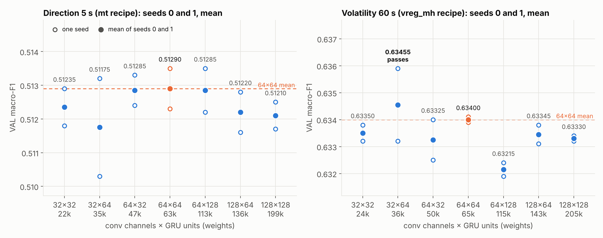

# 2026-11-27 업데이트: conv+GRU 층 폭 실험 (Round 8)

conv+GRU의 층 폭(합성곱 채널 수 × GRU 칸 수, 기존 64×64)을 6가지로 바꿔 두 과제에서 시험했음. 숫자는 모두 `results/direction/width_r8.jsonl`, `results/volatility/width_r8.jsonl`에서 옮겼음.

## 요약

- 방향(5초): 기준을 넘은 폭이 없었음. 최종 모델은 그대로 Round 3 stacking임(검증 0.5194, 테스트 0.5185).
- 변동성(60초): 32×64만 기준을 조금 넘었음. 이 폭으로 바꾼 혼합이 검증 0.6431로 Round 7(0.6430)보다 0.0001 높아서, 정한 규칙대로 변동성 최종 모델을 Round 8로 바꿨음.
- 테스트(한 번만 평가)도 0.6638로 Round 7(0.6637)과 차이가 없었음(+0.0001, 95% 구간 [−0.0001, +0.0003]). 두 모델의 테스트 예측은 99.65% 행에서 같음.
- 가중치를 3배로 늘려도 나아지지 않았음. 폭 사이의 차이는 같은 폭에서 시드만 바꾼 차이(약 0.003)보다 작았음.

## 1. 실험 설계 (실행 전에 고정)

- 폭 (합성곱 채널 × GRU 칸): 32×32, 32×64, 64×32, 64×128, 128×64, 128×128.
- 폭 말고는 기존 설정 그대로임: 방향은 Round 2 `mt`, 변동성은 Round 5 `vreg_mh`.
- 선별: 시드 0·1 평균 검증 macro-F1이 기존 64×64의 시드 0·1 평균(방향 0.51290, 변동성 0.63400)보다 높으면 통과.
- 재현 확인: 바꾼 코드로 64×64 시드 0을 다시 돌려 기존 값과 같은 것(방향 0.5135, 변동성 0.6341)을 먼저 확인했음.
- 후속 (통과한 폭 중 최고만):
  - 방향: 시드 2~9를 더 돌려 Round 3 stacking의 `mt` 자리에 넣고, Round 3(검증 0.5194)보다 높을 때만 테스트.
  - 변동성: 시드 2~4를 더 돌려 Round 7과 같은 방식으로 시장 피처 GBM 회귀와 섞고, Round 7(검증 0.6430)보다 높을 때만 테스트.

## 2. 결과

### 선별 (검증 macro-F1, 시드 0·1 평균)

| 폭 (채널 × 칸) | 방향 가중치 수 | 방향 | 변동성 가중치 수 | 변동성 |
|---|---|---|---|---|
| 64×64 (기존) | 62,735 | 0.51290 | 65,476 | 0.63400 |
| 32×32 | 22,159 | 0.51235 | 23,524 | 0.63350 |
| 32×64 | 35,119 | 0.51175 | 36,132 | **0.63455 (통과)** |
| 64×32 | 46,703 | 0.51285 | 49,796 | 0.63325 |
| 64×128 | 113,231 | 0.51285 | 115,268 | 0.63215 |
| 128×64 | 136,399 | 0.51220 | 142,596 | 0.63345 |
| 128×128 | 199,183 | 0.51210 | 204,676 | 0.63330 |

- 시드별 값과 학습 시간은 [`report/tables/20_width_sweep_val.csv`](../../report/tables/20_width_sweep_val.csv)에 있음.
- 방향에서 가장 가까운 64×32와 64×128도 기준보다 0.00005 낮았음.
- 변동성에서 64×128 이상은 모두 첫 에폭(학습 창 20만 개)에서 검증 최고였고, 그 뒤로는 떨어졌음.



### 변동성 후속 (검증셋, 같은 행 1,062,287개)

- 32×64 시드 2~4: 0.6356 / 0.6358 / 0.6341. 시드 5개 평균 0.6349로 64×64 시드 5개 평균(0.6346)과 거의 같음.
- 혼합: 시장 피처 GBM 회귀 × w + conv+GRU 묶음 × (1 − w), w = 0.1~0.9, 경계값은 검증셋에서 고름.
- 우승: 새 묶음, w = 0.9, 경계값 [2.05, 2.85], 검증 0.6431. 같은 w와 경계값의 Round 7은 0.6430임.
- 반쪽 확인에서는 이득이 보이지 않았음. 앞 6일로 고르면 Round 7 방식이 다시 뽑혔음. 뒤 6일로 고르면 새 묶음(w = 0.7)이 뽑혔지만, 앞 6일에서 0.6249로 Round 7 방식(0.6267)보다 낮았음.

### 변동성 테스트 (한 번만 평가, 같은 행 918,939개)

| | macro-F1 | 차이 (Round 8 − 비교 대상), 95% 구간 |
|---|---|---|
| **Round 8 혼합** | **0.6638** | |
| Round 7 혼합 | 0.6637 | +0.0001 [−0.0001, +0.0003] |
| Round 5 혼합 | 0.6637 | +0.0004 [−0.0034, +0.0050] |
| Round 2 GBM 회귀 + 경계값 | 0.6609 | +0.0031 [0.0000, +0.0069] |

- 구간은 테스트 날짜를 다시 뽑는 부트스트랩(2,000회)으로 구했음.
- 재현율은 잔잔 0.655 / 보통 0.640 / 격렬 0.688로 Round 7과 소수 셋째 자리까지 같음.
- 테스트 10일은 이전 라운드에서도 여러 번 쓴 기간이라 깨끗한 hold-out은 아님.

### 방향 후속

- 통과한 폭이 없어서 시드 추가, stacking 비교, 테스트는 하지 않았음.

## 3. 최종 모델 변화

| 과제 | 이전 | 이후 |
|---|---|---|
| 방향 5초 | Round 3 stacking (검증 0.5194, 테스트 0.5185) | 변경 없음 |
| 변동성 60초 | Round 7 혼합 (검증 0.6430, 테스트 0.6637) | Round 8 혼합 (검증 0.6431, 테스트 0.6638) |

- Round 8은 Round 7과 같고, 비중 0.1인 conv+GRU만 64×64에서 32×64로 바뀌었음.
- 성능은 Round 7과 같다고 보는 것이 맞음. 실제로 달라진 점은 conv+GRU 가중치가 55%로 줄고, 1 에폭 학습 시간이 65초에서 44초(CPU 2스레드)로 줄어든 것임.
- `VOLATILITY.md` 11절의 잔잔 → 격렬 전환 분석은 Round 7로 한 것이고, 그대로 둠(Round 8과 예측이 99.65% 같음).

## 4. 바뀐 파일

**코드**
- `src/common/seq_models.py`: `ConvGRU`에 합성곱 채널 수 `c` 인자를 추가함. 기본값이 64라 이전 결과는 그대로 재현됨.
- `src/direction/deep_v2.py`, `src/volatility/r5.py`: 저장 파일 이름의 앞부분(`PFX`)을 바꿀 수 있게 함. `r5.py`에는 `conv` 설정을 추가함.
- `src/volatility/r5_combine.py`: `test_bag()`이 파일 이름 앞부분(`pfx`)과 채널 수를 받게 함.
- `src/direction/final_r3.py`: 테스트 멤버 계산을 함수(`deep_member`, `test_members`)로 정리함. 동작은 같음.
- 새 파일: `src/direction/width_r8.py`, `src/volatility/width_r8.py` (Round 8 실험), `src/report/plot_width.py` (그림 29).
- `src/report/make_tables.py`: 표 15에 Round 8 행을 넣고 표 20을 추가함.
- `src/volatility/plot_transition.py`, `src/volatility/transition.py`: 그림 27 제목에서 "(final)"을 빼고, 설명에 Round 7이 Round 8 전까지의 최종이었다고 적음.

**결과**
- `results/direction/width_r8.jsonl`, `results/volatility/width_r8.jsonl`: 모든 학습 런과 선별·결합·테스트 기록.
- 가중치 29개: `results/direction/r8_deep_mt_c<채널>_h<칸>_s<시드>.pt` 13개, `results/volatility/r8_w<채널>x<칸>_s<시드>_vol.pt` 16개.
- `results/volatility/predictions/r8_vol_test.npz`: 변동성 최종 모델의 테스트 예측(정답 라벨 제외).
- 표: `report/tables/15_two_tasks_summary.csv` (Round 8 행 추가), `report/tables/20_width_sweep_val.csv` (새 파일).
- 그림: `figures/29_width_sweep.png` (새 파일), `figures/27_vol_confusion_final.png` (제목만 바뀜).

**문서**
- `VOLATILITY.md`: 12절(Round 8)을 추가하고 재현은 13절로 옮김. 결과 표와 요약을 Round 8로 바꾸고, 11절에 분석 대상이 Round 7이라는 설명을 넣음.
- `DIRECTION.md`: 3절(Round 8)을 추가함(이후 절 번호가 하나씩 밀림). 라운드별 결과 표에 Round 8 행을 넣음.
- `README.md`: 결과 표에 Round 8 행(변동성 최종)과 요약 문장을 넣고, 저장소 구조를 고침.
- `results/direction/README.md`, `results/volatility/README.md`, `report/README.md`: 새 파일 설명을 넣음.

**발표 자료**
- 슬라이드를 Round 8 기준으로 고침: 14번 "Round 8 층 폭 바꾸기"를 새로 넣었고(전체 20장), 핵심 결과·변동성 결과·전환 분석·한계·결론·모델 구조 슬라이드의 숫자와 표기를 바꿈.
- 저장소의 `report/presentation/` 파일은 Round 1 시점 자료라 바뀌지 않음.

## 5. 재현

```bash
cd src/volatility
python width_r8.py screen      # 폭 6가지, 시드 0·1 (검증)
python width_r8.py more        # 통과한 폭(32×64)의 시드 2~4
python width_r8.py vol_val     # 혼합 선택 (검증)
python width_r8.py vol_test    # 테스트 (한 번)
cd ../direction
python width_r8.py screen      # 폭 6가지, 시드 0·1 (검증)
python width_r8.py more        # 통과한 폭의 시드 2~9 (이번에는 해당 없음)
python width_r8.py stack       # Round 3 stacking에 넣어 비교 (이번에는 해당 없음)
cd ../report
python make_tables.py          # 표 15, 20
python plot_width.py           # 그림 29
```

자세한 내용은 [`VOLATILITY.md`](../../VOLATILITY.md) 12절과 [`DIRECTION.md`](../../DIRECTION.md) 3절에 있음.
